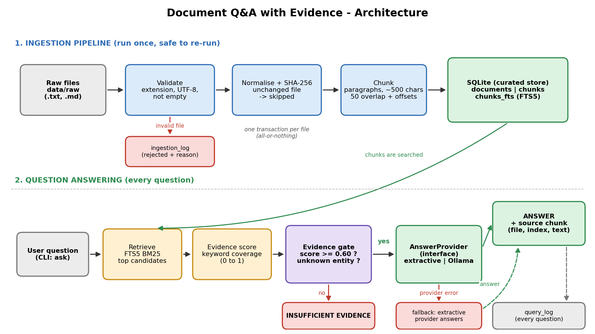
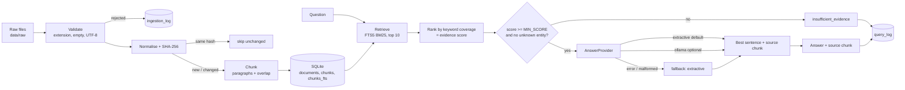

# Architecture



_Regenerate the image with `python docs/make_architecture.py` (needs `pip install matplotlib`). The Mermaid source below renders on GitHub and is kept as an editable text version._




## Layers

| Layer | Module | Responsibility |
|---|---|---|
| Source | `data/raw/` | Synthetic documents (+ 3 deliberately invalid files) |
| Validation | `ingest.read_and_validate` | Extension, encoding, empty-file checks |
| Raw -> curated | `ingest`, `chunking` | Normalise, hash, chunk, transactional load |
| Store | `sql/schema.sql` | documents, chunks, FTS5 index, ingestion_log, query_log |
| Retrieval | `retrieval` | BM25 candidates, keyword-coverage evidence score, unknown-entity check |
| AI seam | `providers/` | `AnswerProvider` interface; extractive and Ollama implementations |
| Orchestration | `qa` | Evidence gate, provider call, fallback, audit logging |
| Interface | `cli` | ingest / ask / eval / stats |

## Data model

```
documents (doc_id PK, filename UNIQUE, content_hash UNIQUE, char_count, status, ingested_at)
    1 --- n
chunks    (chunk_id PK, doc_id FK, chunk_index, text, char_start, char_end, chunk_hash,
           UNIQUE(doc_id, chunk_index))
chunks_fts (FTS5: text, chunk_id UNINDEXED)      -- one row per chunk
ingestion_log (log_id, run_id, filename, status, reason, logged_at)   -- event log
query_log     (query_id, question, status, answer, top_score, chunk_ids, provider, note, asked_at)
```
